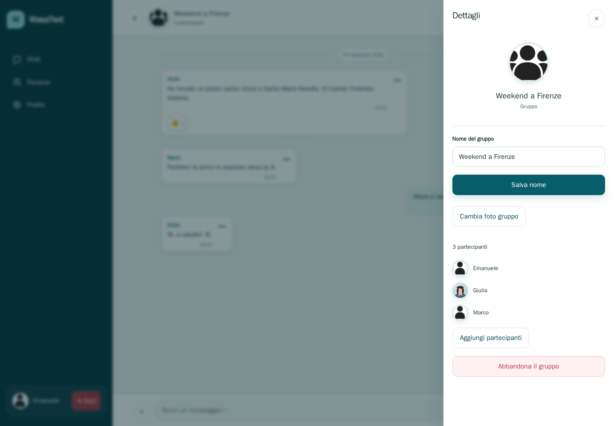

# WASA Project

Applicazione di messaggistica sviluppata con un backend Go e un frontend Vue.



## Versioni

- [`v1.0.0`](https://github.com/Emanuele-Bruni/WASA_project2024/tree/v1.0.0) conserva la prima versione del progetto, così com'era al termine dello sviluppo originale.
- [`main`](https://github.com/Emanuele-Bruni/WASA_project2024/tree/main) contiene la seconda versione, nata per riprendere e approfondire il progetto.

Per consultare V1 localmente senza modificare i branch:

```sh
git switch --detach v1.0.0
```

Per tornare allo sviluppo corrente:

```sh
git switch main
```

## Avvio

L'intera applicazione può essere costruita e avviata con Docker Compose:

```sh
docker compose up -d --build --wait
```

Una volta avviati i container:

- il frontend è disponibile su <http://localhost:8080>;
- il backend è disponibile su <http://localhost:3000>.

Il database SQLite risiede nel volume Docker `backend_data` e conserva utenti, conversazioni e media anche dopo il riavvio dei container. Per eliminare anche i dati persistenti, usare `docker compose down --volumes`.

Le opzioni principali sono in [.env.example](.env.example). Il frontend comunica con il backend tramite il proxy API configurato all'avvio del container.

Al primo avvio il database è vuoto e resta sul computer in cui gira Docker. L'accesso avviene scegliendo uno username, senza password. Per provare un gruppo, accedi con almeno altri due username da sessioni browser separate, poi apri **Conversazioni → Nuovo gruppo** e selezionali.

## Storia

La prima versione è nata come progetto universitario per il corso di **Web and Software Architecture**, nel corso di laurea triennale in Informatica alla Sapienza Università di Roma. Il percorso è partito dalla definizione e documentazione del contratto API in un file YAML (OpenAPI), per poi passare al backend, al frontend e infine ai Dockerfile dei servizi. Questo lavoro full stack mi ha permesso di lavorare su livelli diversi del progetto e di capire come si integrano tra loro.

Dopo aver superato l'esame, ho deciso di riprendere il progetto e approfondirlo. Nella V2 ho rivisto le API e la persistenza SQLite, sviluppato un frontend Vue responsive e curato i flussi di sessione, gruppi, immagini e reazioni. Ho scelto uno sviluppo assistito dall'intelligenza artificiale per imparare a lavorare con uno strumento sempre più presente nello sviluppo software, mantenendo il controllo sulle scelte e sul risultato. Ho realizzato l'interfaccia con CSS, senza ricorrere a Bootstrap.

## Funzionalità

WASA è un'applicazione di messaggistica con accesso tramite username, conversazioni individuali e gruppi. Permette di inviare messaggi di testo e immagini, aggiungere reazioni, inoltrare messaggi e gestire il proprio profilo. L'interfaccia si adatta a schermi desktop e mobili; i dati dell'applicazione sono salvati in SQLite.

## Tecnologie

- **Backend:** Go, API HTTP e SQLite.
- **Frontend:** Vue e JavaScript.
- **Esecuzione:** Docker Compose.

Specifiche: [contratto API OpenAPI](doc/api.yaml) · Licenza: [MIT](LICENSE).
